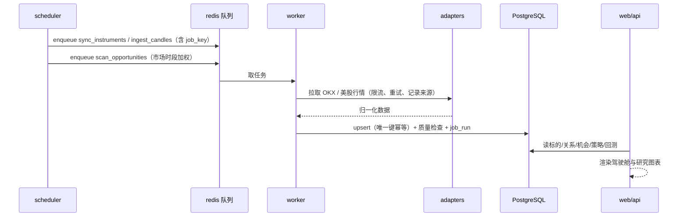

# 总体架构（P1）

本文定义 trading 1.0 P1 阶段的模块边界、依赖方向与运行时形态。实现必须与本文一致；偏离需新增 ADR 或在 PR 中说明并获批。

## 1. 开工核查（2026-11-06）

| 项 | 实测值 | 影响 |
| --- | --- | --- |
| 远程仓库 `git@github.com:justforlxz/trading.git` | `git ls-remote` 返回 0 条 ref；`gh api` `isEmpty: true` | 空仓基线，S1 首个提交即本设计文档集 |
| GitHub Actions | `repos/justforlxz/trading/actions/permissions` = `enabled: true, allowed_actions: all` | 公开仓库，CI 可直接启用，无需自建 runner |
| Python（宿主机） | 3.15.0 | 宿主版本不进入交付物；容器与 CI 统一钉 **3.12** |
| Node / npm | v22.23.2 / 12.0.2，`pnpm` 未安装 | S2 需在 CI 与镜像内安装 pnpm，不依赖开发者本机 |
| Docker / Compose | 29.9.0 / 5.6.0，daemon 可用 | Compose 为本阶段唯一部署形态 |
| OKX 公开行情 | 540 个 SWAP，其中 227 个 `instCategory=3`（股票类），24/7 有成交 | P1 交易标的范围成立，见 `docs/risk/external-dependencies.md` |

## 2. 架构原则

1. **依赖单向**：`adapters（外部 IO）→ ports（协议）← core（纯函数）`，`services` 组合三者，`api`/`jobs` 只做协议编排。core 不 import adapters，analysis 不 import strategy，strategy 不 import 执行。
2. **可计算即可断言**：所有影响决策的计算（相关性、聚类、权重、成本、指标）是纯函数，输入输出确定，可单测与逐位复现。
3. **不做内部微服务**：容器间只有「API 对外」与「DB/Redis 共享」两种通信，服务之间不互相 HTTP 调用，避免把模块边界问题降级成分布式一致性问题。
4. **状态只在数据库**：进程无跨请求内存状态；任务幂等由唯一键与 `job_run` 保证，重启不丢语义。
5. **P1 不预埋未来阶段**：风控、执行、AI 不建目录、不建表、不写逻辑，**也不预留空端口或空接口**；未来阶段真正开工时再按当时的 ADR 引入（见 §9）。

## 3. 模块边界

后端包根 `backend/app/`，每个模块的「不负责」与「负责」同等重要——越界即为架构缺陷。

| 模块 | 负责 | 明确不负责 | 对外接口 |
| --- | --- | --- | --- |
| `config` | 环境变量解析、默认值、连接串 | 业务规则、市场参数 | `Settings` |
| `db` | 引擎、会话、迁移入口、分区与保留策略 | 领域查询语义 | `session_factory`、`alembic` |
| `ports` | 外部依赖协议（行情源、时钟） | 任何实现 | `MarketDataSource`、`EquityDataSource`、`Clock` |
| `adapters/okx` | OKX 公共 REST 拉取、限流、重试、错误码归一 | 入库、分析、决策 | `OkxPublicClient` |
| `adapters/equity` | 真实美股行情拉取（可切换实现）、字段归一 | 与合约价换算、相关性 | `YahooEquitySource` 等 |
| `market` | 标的同步、K 线入库与回补、缺口检测、交易时段、数据质量、来源账本 | 相关性、策略、收益计算 | `/api/v1/market/*`、`market.services.*` |
| `analysis` | 相关性（Pearson/Spearman/滞后）、稳定性、相对强弱、聚类、共振、异常 | 落库、HTTP、任务调度 | 纯函数 `analysis.core.*` |
| `opportunity` | 扫描编排、机会聚合与持久化、机会解释（reasons/evidence） | 生成具体策略参数 | `/api/v1/opportunities*` |
| `strategy` | 模板组合、权重与敞口约束、状态机、审批记录 | 回测、下单 | `/api/v1/strategies*` |
| `backtest` | 事件回放、成本模型、撮合近似、指标、报告数据 | 真实下单、资金划转 | `/api/v1/backtests*` |
| `jobs` | arq 任务定义、调度表达式、重试与幂等键 | 业务计算本身（调用上层模块） | worker/scheduler 入口 |
| `ops` | `job_run`、审计日志、健康与就绪、覆盖度运维视图 | 业务指标口径 | `/api/v1/ops/*`、`/health` |
| `api` | 路由、鉴权（P1 无）、错误信封、序列化 | 领域逻辑 | `/api/v1` |

前端 `frontend/src/`：`pages`（概览/研究/策略/设置）、`features`（按资源分域）、`components`（shadcn 基础件 + 图表封装）、`api`（生成的客户端与类型）、`lib`（主题、格式化）。前端不包含任何业务计算，所有派生值由后端返回。

## 4. 依赖方向

```mermaid
graph TD
  subgraph 入口
    API[api 路由]
    JOBS[jobs worker/scheduler]
    WEB[web SPA]
  end
  subgraph 应用服务
    MKT[market]
    ANL[analysis]
    OPP[opportunity]
    STR[strategy]
    BT[backtest]
    OPS[ops]
  end
  subgraph 领域核心（纯函数）
    ANLC[analysis.core]
    STRC[strategy.core]
    BTC[backtest.core]
  end
  subgraph 外部适配
    OKX[adapters/okx]
    EQ[adapters/equity]
  end
  DB[(PostgreSQL)]
  RD[(Redis)]

  WEB -->|HTTP /api/v1| API
  API --> MKT & ANL & OPP & STR & BT & OPS
  JOBS --> MKT & OPP & STR & BT & OPS
  OPP --> ANL
  STR --> STRC
  BT --> BTC & MKT
  MKT --> OKX & EQ
  ANL --> ANLC
  MKT & OPP & STR & BT & OPS --> DB
  JOBS --> RD
  API -.只读查询.-> DB
```

禁止的依赖（评审时直接拒绝）：`analysis → strategy`、`strategy → backtest`、`core → adapters`、任何模块 `→ api`、服务之间 `→ 对方的 service`（只能经 DB 或纯函数）。

## 5. 运行容器与启动顺序

| # | 服务 | 镜像 | 端口 | 健康检查 | 依赖（compose `condition`） |
| --- | --- | --- | --- | --- | --- |
| 1 | `postgres` | `postgres:16-alpine` | 5432（仅内网） | `pg_isready -U trading` | — |
| 2 | `redis` | `redis:7-alpine` | 6379（仅内网） | `redis-cli ping` | — |
| 3 | `api` | 自建 `backend/Dockerfile` | 8000 | `GET /health` | postgres healthy、redis healthy |
| 4 | `worker` | 同 api 镜像 | 无 | `arq --check` / 进程探针 | api healthy |
| 5 | `scheduler` | 同 api 镜像 | 无 | 进程探针 | api healthy |
| 6 | `web` | 自建 `frontend/Dockerfile`（nginx） | 5173→80 | `GET /` | api healthy |

启动顺序即依赖链：`postgres`/`redis` → `api`（entrypoint 执行 `alembic upgrade head`，幂等）→ `worker`/`scheduler` → `web`。`api` 不就绪时 `worker` 不与数据库竞赛迁移。

各容器的职责边界：

| 服务 | 负责 | 不负责 |
| --- | --- | --- |
| `postgres` | 唯一持久化真相；schema 隔离；分区与保留 | 业务校验、跨域事务编排放在应用层 |
| `redis` | 任务队列、短期缓存、限流计数 | 不作为唯一真相；丢失后可从 DB 与外部源重建 |
| `api` | 同步请求、读查询、写入校验、错误信封 | **不执行长任务**（扫描/回补/回测一律入队），不持有跨请求状态 |
| `worker` | 执行 `jobs` 中的任务、写 `job_run`、失败重试 | 不对外暴露端口，不做定时决策 |
| `scheduler` | 按 cron 与市场时段投递任务（同一镜像、独立进程） | 不直接做重计算；重复投递由幂等键吸收 |
| `web` | 静态资源、SPA 路由回退、`/api` 反代 | 不缓存业务数据、不做鉴权决策 |

> 与 S2 验收条目的偏差：S2 只列了 api/worker/web/postgres/redis 五个服务。本设计需要第 6 个 `scheduler`：定时采集必须与请求处理隔离，否则 API 重启会打断采集、cron 也无法随进程扩展。S2 按六服务实现，并在验收记录中标注该偏差。

## 6. 主数据流



规则：任何写路径都必须能重复执行而不产生副本（唯一键或 `job_key`）；任何读路径都不触发外部 IO。

## 7. 故障域与降级

| 故障 | 影响面 | 检测 | 处置 |
| --- | --- | --- | --- |
| `postgres` 不可用 | 全部读写失败（API 5xx） | `/health` 就绪探针 | 重启；P1 不做跨库降级，直接暴露失败 |
| `redis` 不可用 | 新任务停止投递；API 读不受影响 | worker 心跳、队列长度告警 | 重启；积压任务按 `job_key` 去重后重放 |
| OKX 限流（429 / code 50011） | 该轮采集延迟，K 线出现缺口 | `data_quality_issue` + `data_source_sync` | 指数退避、按 `instId` 分片、下一轮补洞 |
| 真实美股源不可用 | 关系分析降级为 OKX 指数口径 | 采集失败计数、`source` 字段缺失率 | 标记数据来源降级并在 UI 明示，不用伪造数据填补 |
| `scheduler` 停止 | 数据不再更新（数据陈旧） | `data_source_sync.last_success_at` 超阈值 | 重启；陈旧标记由 API 返回 `stale: true` |
| `worker` 崩溃 | 任务中断，`job_run` 停在 running | `job_run.started_at` 超时 | 租约超时后重新投递（幂等键保证不重复落库） |
| `web` 故障 | 仅界面不可用，API 仍可被脚本调用 | 容器健康检查 | 重启；前端无状态，可直接替换 |

数据面的单向依赖：OKX 不可用时**不允许**用真实股价格反推合约价；只能标记该周期数据缺失。

## 8. 部署形态

- 开发与自托管：`infra/docker-compose.yml` 六服务，命名卷 `pgdata`、`redisdata`。
- 生产：同一镜像部署到 Kubernetes，`api` 与 `web` 为 Deployment + Service，`worker`/`scheduler` 为单副本 Deployment，`postgres`/`redis` 用托管或 StatefulSet。容器不写本地磁盘，日志走 stdout。
- 配置只经环境变量注入（`.env.example` 为唯一清单），代码中不含密钥。

## 9. P1 边界

不在本阶段：账户与密钥管理、下单与撤单、持仓同步、风控拦截、模拟撮合、AI 生成策略、告警推送。`risk`/`execution`/`ai` 目录在 P1 不存在，避免空壳抽象。
