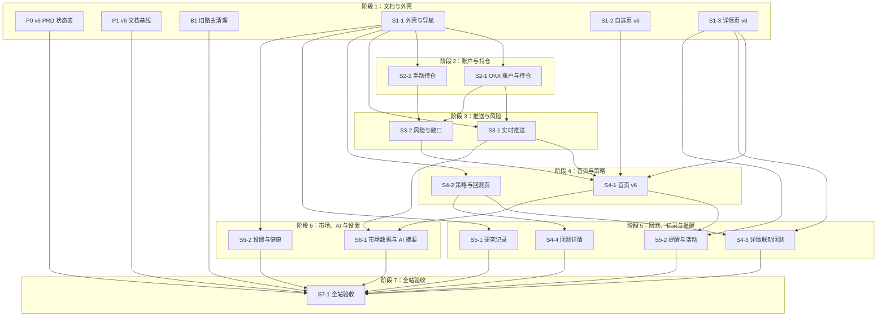

# trading v6 交付计划

> 版本：v1.0  
> 日期：2026-11-13  
> 对应总控：MKACG-807

## 1. 文档地位

本文是 v6 交付计划的唯一来源，记录阶段、节点、依赖、接口契约、迁移归属和旧代码删除归属。

- 产品范围与功能实现状态在 `docs/prd/v6.md`，由 P0 建立，后续执行 issue 更新。
- 已确认的功能与数据规格在 `docs/prd/v6-data-spec.md`，与本文冲突时以规格为准。
- 领域规则与历史决策在 `docs/prd/v2.md` 和 `docs/prd/decisions.md`。
- 工程约定在 `AGENTS.md`。
- issue 只承载本次执行范围、依赖、验收和状态，不复制本文正文。

修改顺序固定：先改本文并合并，再修改或创建执行 issue。接口、依赖或删除归属发生变化时，在同一个 PR 里说明受影响的 issue。

## 2. 产品边界

产品范围、页面功能、数据口径和验收基线以 `docs/prd/v6.md` 与 `docs/prd/v6-data-spec.md` 为准，本文不复制正文。

本文执行时始终遵守以下边界：

- 本版本不接真实下单、撤单、改单和平仓，不做策略自动执行，不做多用户和 SaaS。
- OKX 账户与持仓只读；手动持仓只做本地记账；策略只用于观察信号和回测。
- live、delayed、stale、demo、backtest 数据必须在 API 和界面上明确区分。
- 浏览器不接触 OKX Secret，所有交易所访问都经过服务端。
- 前端不计算指标、相关系数、盈亏、成本、风险和覆盖率等派生值，这些值由后端返回。

## 3. 阶段图与阶段表

### 3.1 阶段图

后端包 B2 到 B9 是阶段内的实现拆分，不在产品节点图里单独出现；它们与节点的对应关系见 §5 和 §7。



### 3.2 阶段表

共 7 个阶段、19 个节点：P0、P1、B1 和 16 个 S 节点。每个阶段的闸门必须是可以用命令、接口响应、截图或数据库查询直接观察的判据。

| 阶段 | 节点 | 交付物 | 闸门 |
| --- | --- | --- | --- |
| 1 | P0 v6 PRD 状态表<br>P1 v6 文档基线<br>B1 旧路由清理<br>S1-1 外壳与导航<br>S1-2 自选页 v6<br>S1-3 详情页 v6 | `docs/prd/v6.md` 功能总表与前后端状态；删除 v6 没有对应页面的旧前端页面与旧 HTTP 路由；v6 的 6 项导航、响应式抽屉、自选页、标的详情分析页 | 旧页面、旧路由、旧客户端函数没有残留；1440px 与 390px 可用；搜索、增删自选、详情切换、指标与数据覆盖都来自真实 API；没有假数字 |
| 2 | S2-1 OKX 账户与持仓<br>S2-2 手动持仓 | 只读账户权益与交易所持仓；手动持仓创建、买卖、流水、成本重算 | 浏览器不接触 Secret；OKX 区只读；手动操作可追溯；刷新后数据一致 |
| 3 | S3-1 实时推送<br>S3-2 风险与敞口 | 服务端汇总 OKX WebSocket 后推给浏览器；持仓风险与敞口计算 | 自选、详情、持仓价格由推送更新；断线可恢复；每条风险能追溯到输入字段和规则 |
| 4 | S4-1 首页 v6<br>S4-2 策略与回测页 | 账户、风险、持仓、自选、策略首页；策略参数与回测记录 | 首页每个模块独立降级，不显示假数字；策略版本和参数可复现 |
| 5 | S4-3 详情联动回测<br>S4-4 回测详情<br>S5-1 研究记录<br>S5-2 提醒与活动 | 详情关联策略；K 线买卖标记、净值回撤与回放；假设、结论、决策、复盘 CRUD；服务端提醒与活动事件 | 从策略和从自选详情两个入口都能发起回测；回放只读已保存序列；记录可关联标的、策略和回测；提醒与活动来自事件表，前端不拼文案 |
| 6 | S6-1 市场数据与 AI 摘要<br>S6-2 设置与健康 | NASDAQ、S&P 500、DOW、VIX、BTC，财报与新闻，带来源的摘要；设置与系统健康 | 每条摘要能回溯来源；过期数据显式提示；健康状态来自真实检查 |
| 7 | S7-1 全站验收 | 清理演示数据与环境标签，端到端走查，执行旧代码残留检查，核对 PRD 状态 | 所有页面无硬编码业务数值；live、delayed、stale、demo、backtest 不混排；`rg` 查不到已删除页面、路由、API 路径、schema 和 feature flag；`docs/prd/v6.md` 的每行状态与代码一致 |

阶段 5 的排列说明：MKACG-807 的评论已决定把 S4-3、S4-4 从阶段 4 移到阶段 5，避免与 S4-2 同时开工、互相等待。本文按该评论记录；MKACG-807 的阶段表正文如仍未同步，由 PL 在该 issue 内更新。

## 4. 节点清单

节点编号固定，不随阶段调整而重编。新的工作只能追加新编号；删除节点时保留编号并在本文记录原因。

### P0 v6 PRD 状态表

- 阶段：1
- 范围：建立 `docs/prd/v6.md`，按页面和功能列出前端、后端两列状态；状态只能取 `已实现`、`开发中`、`未实现`、`不适用`；建立“已删除”小节。
- 依赖：无。P0 与 P1 都只改 `docs/`，文件不同，可以并行。
- 验收要点：每个功能行都有前端和后端状态；状态与本文节点对应；已删除项写明删除归属节点。
- 对应 issue：MKACG-821。

### P1 v6 文档基线

- 阶段：1
- 范围：把已确认规格逐字写入 `docs/prd/v6-data-spec.md`；编写本文；在 `AGENTS.md` 增补“文档与 issue 的关系”。
- 依赖：无。读取 MKACG-807、MKACG-808 到 MKACG-820 的范围与验收。
- 验收要点：规格与附件 `diff` 无输出；本文九节齐全；19 个节点都有稳定编号；接口契约表覆盖规格第 7 节的每个 API；删除归属表覆盖要求的旧实现；`AGENTS.md` 新增一节不超过 10 行；只改文档。
- 对应 issue：MKACG-822。

### B1 旧路由清理

- 阶段：1
- 范围：删除后端 `/api/relations*`、`/api/portfolio*`、`/api/journal` 路由、只被它们使用的 schema、路由测试和 `app/relations` 包；后端路由变化后重新生成前端 `src/api/types.ts`。
- 依赖：无。只改后端路由与测试，可以与 S1-1、S1-2、S1-3 并行。
- 验收要点：`rg` 查不到旧路由、旧 schema 和旧测试引用；`make lint`、`make test` 通过；前端生成类型与后端 OpenAPI 一致；不保留兼容路由和别名。
- 对应 issue：MKACG-820。

### S1-1 外壳与导航

- 阶段：1
- 范围：主导航改为概览、自选、持仓、策略与回测、记录、设置 6 项；左侧固定侧栏、顶栏、内容区布局按原型；`≤1080px` 使用抽屉，`≤640px` 收窄内边距并禁止整体横向溢出；新增 `/positions` 和 `/journal` 页面骨架；扩展 `PageHeading`；顶栏显示真实连接状态；删除前端 `/relations`、`/portfolio`、`/trades` 页面、路由、导航项、只被它们使用的 API 客户端函数和 MSW handler。
- 依赖：P1 的文档基线。与 S1-2、S1-3 的文件边界不同，可以并行；前端生成类型由 B1 重新生成，S1-1 不手改。
- 验收要点：6 个导航项和当前区块高亮正确；抽屉可用遮罩、Esc 和导航项关闭；1440px 与 390px 走查通过；后端不可用时顶栏显示“未连接”；`pnpm --dir frontend lint` 和 `build` 退出码 0；截图齐全。
- 对应 issue：MKACG-808。

### S1-2 自选页 v6

- 阶段：1
- 范围：搜索标的、加入和移出自选、分组、分类筛选、排序；表格展示标的代码、名称、最新价、日涨跌幅、趋势、RSI(14)、ATR(14) 百分比、有效 K 线数量、最近更新时间和数据质量；自选概览与市场环境使用后端聚合值。
- 依赖：P1。与 S1-1、S1-3 并行；只改自选页及其数据请求。
- 验收要点：搜索和增删来自真实 API；指标列由后端返回；无数据时显示空态；前端不做派生计算；`lint` 和 `build` 通过。
- 对应 issue：MKACG-809。

### S1-3 详情页 v6

- 阶段：1
- 范围：面包屑导航；`GET /api/instruments/{id}/analysis` 聚合接口与页面；周期切换、K 线与 MA 叠加、趋势、动量、波动、成交量、相对强弱、关键价位、关联资产、关联策略、近期事件、数据覆盖。
- 依赖：P1。与 S1-1、S1-2 并行；只改详情页及其数据请求。
- 验收要点：每个模块的数据都来自真实接口；没有完整数据的周期禁用并写明原因；数据覆盖显示起止时间、数量、缺口和最后同步时间；`lint` 和 `build` 通过。
- 对应 issue：MKACG-810。

### S2-1 OKX 账户与持仓

- 阶段：2
- 范围：持仓页的 OKX 只读区；账户区使用 `GET /api/account/summary`，显示账户权益、可用权益、已用保证金、未实现盈亏、今日盈亏、持仓名义价值和保证金使用率；持仓明细使用 `GET /api/positions`，交易所持仓按 `source=exchange` 展示。
- 依赖：B2（含 `GET /api/positions` 合并视图的后续增量）、S1-1。
- 验收要点：浏览器不接触 Secret；OKX 区没有下单、撤单、改单和平仓入口；刷新后数据一致；价格和盈亏标明来源与时间；`position_notional` 和 `day_pnl_pct` 在 B2 补齐前显示“未提供”，不在前端计算。
- 对应 issue：未创建，阶段 1 闸门通过后由 PL 创建。

### S2-2 手动持仓

- 阶段：2
- 范围：手动持仓创建、买入、卖出、更正、流水查看和成本重算展示；写入使用 `POST /api/manual-positions` 和 `POST /api/manual-positions/{id}/trades`，每次请求带 `idempotency_key`；与 OKX 持仓合并显示时保留 `source=manual`。
- 依赖：B2、S1-1。
- 验收要点：每次操作都写入不可覆盖的流水；重复请求不会重复入账；刷新后数量和成本一致；没有匹配行情时显示“无行情源”，不用相似标的替代。
- 对应 issue：未创建，阶段 1 闸门通过后由 PL 创建。

### S3-1 实时推送

- 阶段：3
- 范围：浏览器消费服务端推送的行情、账户和持仓事件；自选、详情、持仓页的价格由推送更新；断线重连和前端节流。
- 依赖：B4、S1-1、S2-1。
- 验收要点：浏览器不直接连接 OKX；断线后能恢复并补齐快照；同一标的的高频更新按约定节流；事件带来源和时间。
- 对应 issue：未创建，阶段 2 闸门通过后由 PL 创建。

### S3-2 风险与敞口

- 阶段：3
- 范围：持仓页敞口区；止损距离、ATR 距离、杠杆、单标的占比、保证金使用率、行业敞口和综合风险等级。
- 依赖：B3、S2-1、S2-2。
- 验收要点：每条风险都能追溯到输入字段、计算值、阈值和规则 ID；风险等级不由 AI 单独决定；高杠杆阈值可配置。
- 对应 issue：未创建，阶段 2 闸门通过后由 PL 创建。

### S4-1 首页 v6

- 阶段：4
- 范围：账户概览、风险监控、当前持仓、市场概况、市场摘要、关注列表、提醒与活动、策略运行。
- 依赖：B5（B2、B3、B4）、S1-2、S1-3、S3-1、S3-2。
- 验收要点：每个模块独立降级；数据源失效时显示“陈旧”或“不可用”，不把旧值当实时值；页面没有硬编码业务数值。
- 对应 issue：未创建，阶段 3 闸门通过后由 PL 创建。

### S4-2 策略与回测页

- 阶段：4
- 范围：策略列表、创建、编辑、状态、规则 JSON、参数、标的关联和回测记录；从页面发起回测。
- 依赖：B6、S1-1。
- 验收要点：策略版本和参数可复现；历史回测引用的版本不被后续修改覆盖；规则以可序列化结构保存，不只存自然语言。
- 对应 issue：未创建，阶段 3 闸门通过后由 PL 创建。

### S4-3 详情联动回测

- 阶段：5
- 范围：标的详情页的关联策略区；从详情页进入策略回测；与 S4-2 共用策略选择和回测入口。
- 依赖：S4-2、B7、S1-3；必须在 S4-2 合并后放行。
- 验收要点：从策略页和从详情页发起的同一策略、同一参数、同一区间得到同一回测结果；关联策略显示最近回测收益、最大回撤、交易数和回测日期。
- 对应 issue：未创建，阶段 4 闸门通过后由 PL 创建。

### S4-4 回测详情

- 阶段：5
- 范围：回测概要指标和测试口径；K 线进出场标记；历史回放；净值和回撤图；交易明细筛选与 CSV 导出；稳健性检查和复盘入口。
- 依赖：S4-2、B7；必须在 S4-2 合并后放行。
- 验收要点：回放只读取已保存的输入序列和结果序列，不访问实时行情；CSV 与筛选结果一致；进出场标记与交易明细一致。
- 对应 issue：未创建，阶段 4 闸门通过后由 PL 创建。

### S5-1 研究记录

- 阶段：5
- 范围：假设、回测结论、决策、复盘四种记录的创建、编辑、删除、筛选、排序、关联对象和数量统计。
- 依赖：B8、S1-1。
- 验收要点：记录可以关联标的、策略和回测；用户内容不被 AI 自动改写；筛选和详情完整。
- 对应 issue：未创建，阶段 4 闸门通过后由 PL 创建。

### S5-2 提醒与活动

- 阶段：5
- 范围：首页提醒与活动卡片，详情页提醒区；确认和忽略提醒；活动流水按时间和类型筛选。
- 依赖：B8、S4-1、S1-3。
- 验收要点：提醒和活动来自数据库事件表；同一标的、同一规则、同一根 K 线不重复生成；状态变化写入活动流水；前端不拼文案。
- 对应 issue：未创建，阶段 4 闸门通过后由 PL 创建。

### S6-1 市场数据与 AI 摘要

- 阶段：6
- 范围：首页 NASDAQ、S&P 500、DOW、VIX、BTC 市场概况；带来源和生成时间的 AI 摘要；详情页宏观、财报和公告事件。
- 依赖：B9（B4、B5）、S4-1、S3-1。
- 验收要点：五个指标都带来源、时间和延迟状态；每个摘要事实点至少一条来源；没有来源的句子不输出；数据过期时显式提示。
- 对应 issue：未创建，阶段 5 闸门通过后由 PL 创建。

### S6-2 设置与健康

- 阶段：6
- 范围：设置页保留数据连接、显示偏好、风险默认值、自动执行开关、密钥状态与健康；自动执行开关按规格 §3.8 保留，默认 `false`，只保存状态，不实现真实下单；系统健康展示数据库、OKX REST、OKX WebSocket、外部 Provider、任务队列和 K 线覆盖。
- 依赖：B9、S1-1。
- 验收要点：Secret 和 Passphrase 不回显，API Key 只显示掩码；自动执行开关默认关闭，修改后不产生任何真实订单；每个健康项来自真实检查并有最后成功时间；旧的执行模式、紧急停止、成本、回测默认值和代理分组从页面和接口响应中删除。
- 对应 issue：未创建，阶段 5 闸门通过后由 PL 创建。

### S7-1 全站验收

- 阶段：7
- 范围：清理演示数据和环境标签；端到端走查全部页面；执行旧代码残留检查；核对 `docs/prd/v6.md` 的每行状态与代码一致。
- 依赖：P0、P1、B1、阶段 1 到阶段 6 的全部节点。
- 验收要点：所有页面没有硬编码业务数值；live、delayed、stale、demo、backtest 不混排；本文 §8.3 的每条 `rg` 命令无输出或只命中允许的历史说明、测试 fixture 和本文档；PRD 状态与代码一致。
- 对应 issue：未创建，阶段 6 闸门通过后由 PL 创建。

## 5. 后端包与迁移归属

后端包是阶段内的实现拆分，不是独立的产品节点。每个包有唯一的迁移归属；其他包不得创建迁移或加列。

| 包 | 阶段 | 交付物 | 迁移 | 依赖 | 前端消费方 | 对应 issue |
| --- | --- | --- | --- | --- | --- | --- |
| B2 持仓数据与 API | 2 | `GET /api/account/summary` 与 `POST /api/account/sync`、交易所持仓只读快照、手动持仓与流水；`GET /api/positions` 合并视图仍为开发中，由 B2 后续增量交付 | 0015 | 无 | 持仓页、首页账户卡 | MKACG-812 |
| B3 风险与敞口 | 3 | 止损距离、ATR 距离、杠杆、单标的占比、保证金使用率、行业敞口 | 无 | B2 | 持仓页敞口区、首页风险卡 | MKACG-813 |
| B4 实时推送 | 3 | 服务端汇总 OKX WebSocket，向浏览器推送行情、账户、持仓事件 | 无 | B2（私有频道） | 自选、详情、持仓、首页 | MKACG-814 |
| B5 首页汇总 | 4 | `GET /api/dashboard/summary`，按模块独立降级 | 无 | B2、B3、B4 | 首页 | MKACG-815 |
| B6 策略 v6 后端 | 4 | 策略、版本、规则 JSON、标的关联、CRUD | 0016 | 无 | 策略与回测页、详情关联策略 | MKACG-816 |
| B7 回测 v6 后端 | 4 | K 线买卖标记、净值与回撤、回放序列、交易筛选与 CSV | 无 | B6、现有回测引擎 | 回测详情、详情回测入口 | MKACG-817 |
| B8 记录、提醒与活动 | 5 | 研究记录 CRUD、提醒事件、活动事件、去重与状态 | 0017 | B2、B3、B6 | 记录页、首页提醒与活动、详情提醒 | MKACG-818 |
| B9 外部市场、AI 与设置健康 | 6 | 市场指数、VIX、BTC、财报与新闻、带来源的 AI 摘要、系统健康 | 0018 | B4、B5 | 首页市场概况与摘要、设置页 | MKACG-819 |

### 5.1 迁移与并行规则

| 迁移 | 唯一负责包 | 内容归属 |
| --- | --- | --- |
| 0015 | B2 | 账户快照、交易所持仓快照、手动持仓、手动流水 |
| 0016 | B6 | 策略、策略版本、策略标的关联、策略信号 |
| 0017 | B8 | 研究记录、提醒事件、活动事件 |
| 0018 | B9 | 市场事件、新闻条目、数据同步任务、设置扩展 |

- 合并前 `alembic heads` 必须只有一个头。如果 B2 的 0015 还没合并，B6 不得先写 0016。
- 不依赖迁移的包（B3、B4、B5、B7）可以在前置包合并后并行，各自改独立模块，不碰同一批文件。
- B7 与 B6 都属于回测与策略能力，但 B7 依赖 B6 的策略版本和回测关联，必须在 B6 合并后放行。
- 表结构只能由 Alembic 迁移变更，不得在代码里建表或手改表结构。

## 6. API 契约表

本节以 `docs/prd/v6-data-spec.md` 第 7 节为准。规格第 7 节列出 26 行、31 个方法与路径；本表另外登记 2 个已经合并的账户接口，共 33 行。

通用约定：

- 所有路径都以 `/api` 开头，JSON 字段使用 `snake_case`，时间使用 ISO-8601 UTC 并带 `Z`，`Decimal` 以字符串返回。
- 错误响应统一为 `{"detail": "..."}`，沿用 `backend/app/api/errors.py` 的现有约定；表中的“错误码”是 HTTP 状态码。
- 行情、账户、持仓、事件等外部数据都带 `source`、`as_of`、`received_at`、`is_delayed`、`quality_status`。`quality_status` 取 `normal`、`missing`、`delayed`、`abnormal`、`pending`。
- `quote` 是共享对象：`{last_price, mark_price, index_price, change, change_pct, source, as_of, received_at, is_delayed, quality_status}`，三种价格不得合并成一个 `price` 字段。
- 分页响应使用 `{items, next_cursor}`；`next_cursor` 为空表示没有下一页。
- 负责列写实现归属：B2 到 B9 是 §5 登记的后端包；S1-2、S1-3 是阶段 1 的前端节点，它们的后端能力属于现有模块，不新增包。

| 方法 | 路径 | 请求字段 | 响应字段 | 错误码 | 负责节点或包 |
| --- | --- | --- | --- | --- | --- |
| GET | `/api/dashboard/summary` | 无 | `as_of`、`market`、`account`、`risk`、`positions`、`watchlist`、`alerts`、`strategies`、`activity`、`degraded[{module,status,reason,last_success_at}]` | 200（部分模块可为 `null`）、503 | B5 |
| GET | `/api/market/overview` | 无 | `as_of`、`items[{symbol,name,value,change,change_pct,market_session,source,as_of,is_delayed,quality_status}]`，`symbol` 固定为 `NASDAQ`、`SP500`、`DOW`、`VIX`、`BTC` | 502、503 | B9 |
| GET | `/api/account/summary` | 无 | `status`（`ok`、`stale`、`unconfigured`）、`account_id`、`currency`、`equity`、`available_equity`、`cash_balance`、`unrealized_pnl`、`used_margin`、`available_margin`、`margin_usage_pct`、`day_pnl`、`day_pnl_basis`、`position_notional`（待 B2 补齐）、`day_pnl_pct`（待 B2 补齐）、`captured_at`、`source` | 200（未配置或没有快照时 `status` 为 `unconfigured` 或 `stale`，不用错误码） | B2 |
| POST | `/api/account/sync` | 无 | 与 `GET /api/account/summary` 相同，另加 `positions_synced` | 200（未配置时 `status=unconfigured`）、502（上游失败） | B2 |
| GET | `/api/instruments?query=` | `query`、`asset_class`（可选）、`limit`（可选，默认 20） | `items[{instrument_id,venue,inst_id,inst_type,base_asset,quote_asset,display_symbol,asset_class,name,state,tradable}]` | 400 | S1-2 |
| GET | `/api/watchlist` | 无 | `items[{instrument_id,display_symbol,name,asset_class,quote,trend,rsi14,atr_pct,candle_count,last_updated_at,quality_status}]`、`summary{total,bullish,bearish,coverage_pct}`、`market_environment{risk_appetite,breadth,volatility,computed_at,rule_version}` | 503 | S1-2 |
| POST | `/api/watchlist/items` | `instrument_id`、`group_id`（可选）、`sort_order`（可选） | 201：`id`、`instrument_id`、`sort_order`、`created_at` | 400、404、409 | S1-2 |
| DELETE | `/api/watchlist/items/{id}` | 路径参数 `id` | 204，无响应体 | 404 | S1-2 |
| GET | `/api/instruments/{id}/analysis?bar=1D` | 路径参数 `id`；`bar` 取 `1m`、`5m`、`15m`、`1h`、`4h`、`1d`，默认 `1d` | `instrument`、`bar`、`quote`、`candles[{ts,open,high,low,close,volume,volume_ccy,source,is_complete}]`、`indicators{ma20,ma60,ma20_distance_pct,rsi14,macd{value,signal,histogram},atr14,atr_pct,volume_ratio_20d}`、`relative_strength{window,symbol_return,benchmark_instrument_id,benchmark_return,excess_return}`、`levels{high_20d,low_20d,distance_to_high_pct,distance_to_low_pct}`、`correlations[{instrument_id,display_symbol,window,coefficient,sample_count,computed_at}]`、`events`、`linked_strategies`、`coverage{bar,start,end,candle_count,gap_count,last_synced_at}`、`generated_at` | 400、404、503 | S1-3 |
| GET | `/api/positions` | `source`（可选，取 `exchange` 或 `manual`） | `items[{id,source,inst_id,display_symbol,name,asset_class,pos_side,size,avg_px,mark_px,upl,upl_ratio,lever,mgn_mode,liq_px,margin,notional_value,stop_px,price_status,updated_at}]` | 503 | B2 |
| POST | `/api/manual-positions` | `inst_id`、`side`、`quantity`、`avg_cost`、`stop_px`（可选）、`leverage`（可选）、`note`（可选）、`idempotency_key` | 201：`id`、`inst_id`、`display_symbol`、`name`、`asset_class`、`side`、`quantity`、`avg_cost`、`stop_px`、`leverage`、`status`、`note`、`price`、`price_status`、`price_source`、`market_value`、`unrealized_pnl`、`created_at`、`updated_at` | 400、404、409 | B2 |
| POST | `/api/manual-positions/{id}/trades` | 路径参数 `id`；`action`（`open`、`add`、`reduce`、`close`、`correct`）、`quantity`、`price`、`fee`（默认 `"0"`）、`occurred_at`、`note`（可选）、`idempotency_key` | 201：`id`、`position_id`、`action`、`quantity`、`price`、`fee`、`realized_pnl`、`position_quantity_after`、`position_avg_cost_after`、`position_status_after`、`occurred_at`、`note`、`created_at` | 400、404、409 | B2 |
| GET | `/api/manual-positions/{id}/trades` | 路径参数 `id` | `items[{id,position_id,action,quantity,price,fee,realized_pnl,position_quantity_after,position_avg_cost_after,position_status_after,occurred_at,note,created_at}]`（沿用已合并 B2 响应，不分页） | 404 | B2 |
| GET | `/api/alerts` | `status`、`type`、`severity`、`instrument_id`、`limit`、`cursor`（均可选） | `items[{id,type,severity,instrument_id,title,detail,payload,rule_id,rule_version,status,triggered_at,expires_at}]`、`next_cursor` | 400 | B8 |
| PATCH | `/api/alerts/{id}` | 路径参数 `id`；`status` 取 `acknowledged` 或 `ignored` | 200：更新后的 `alert` | 400、404、409 | B8 |
| GET | `/api/activity` | `event_type`、`object_type`、`from`、`to`、`limit`、`cursor`（均可选） | `items[{id,event_type,object_type,object_id,summary,payload,created_at}]`、`next_cursor` | 400 | B8 |
| GET | `/api/strategies` | `status`、`category`、`limit`、`cursor`（均可选） | `items[{id,name,category,status,current_version_id,timeframe,updated_at}]`、`next_cursor` | 400 | B6 |
| POST | `/api/strategies` | `name`、`category`、`description`（可选）、`timeframe`、`direction`、`rule_json`、`parameters`、`instrument_ids`、`cost_model`（可选）、`position_sizing`（可选） | 201：`id`、`version_id`、`status`、`created_at` | 400、404、409 | B6 |
| GET | `/api/strategies/{id}` | 路径参数 `id` | `id`、`name`、`category`、`description`、`status`、`current_version_id`、`timeframe`、`direction`、`rule_json`、`parameters`、`cost_model`、`position_sizing`、`instrument_ids`、`versions[{version_id,created_at,change_note}]`、`created_at`、`updated_at` | 404 | B6 |
| PUT | `/api/strategies/{id}` | 路径参数 `id`；`name`、`description`、`rule_json`、`parameters`、`instrument_ids`、`status`（均可选，至少一项） | 200：`id`、`version_id`（新版本）、`status`、`updated_at` | 400、404、409 | B6 |
| POST | `/api/backtests` | `strategy_version_id`、`instrument_ids`、`timeframe`、`start_date`、`end_date`、`initial_capital`、`quote_currency`、`fee_model`、`slippage_model`、`funding_model`、`signal_timing`、`allow_short`、`position_rules`、`risk_constraints` | 202：`backtest_id`、`status`、`job_id` | 400、404、409、503 | B7 |
| GET | `/api/backtests/{id}` | 路径参数 `id` | `id`、`strategy_version_id`、`status`、`params_snapshot`、`data_version`、`cost_model`、`started_at`、`finished_at`、`metrics{total_return,annualized_return,max_drawdown,sharpe,win_rate,profit_factor,trade_count,avg_holding_period,max_consecutive_losses}`、`warnings`、`reproducibility` | 404 | B7 |
| GET | `/api/backtests/{id}/equity` | 路径参数 `id` | `items[{ts,equity,benchmark_equity,drawdown}]` | 404 | B7 |
| GET | `/api/backtests/{id}/trades` | 路径参数 `id`；`side`、`pnl_sign`、`instrument_id`、`limit`、`cursor`（均可选） | `items[{instrument_id,side,entry_time,entry_price,exit_time,exit_price,quantity,fee,funding,slippage,gross_pnl,net_pnl,return_pct,exit_reason}]`、`next_cursor`、`total` | 400、404 | B7 |
| GET | `/api/backtests/{id}/replay` | 路径参数 `id`；`from`、`to`、`step`（均可选） | `items[{bar_index,ts,candle,indicators,signal,position,cash,equity}]` | 400、404 | B7 |
| GET | `/api/research-notes` | `type`、`related_instrument_id`、`related_strategy_id`、`related_backtest_id`、`limit`、`cursor`、`sort`（均可选） | `items[{id,type,title,content,related_instrument_id,related_strategy_id,related_backtest_id,tags,created_at,updated_at}]`、`next_cursor` | 400 | B8 |
| POST | `/api/research-notes` | `type`、`title`、`content`、`related_instrument_id`（可选）、`related_strategy_id`（可选）、`related_backtest_id`（可选）、`tags`（可选） | 201：`id`、`type`、`title`、`created_at` | 400、404 | B8 |
| PUT | `/api/research-notes/{id}` | 路径参数 `id`；`type`、`title`、`content`、`related_instrument_id`、`related_strategy_id`、`related_backtest_id`、`tags`（均可选，至少一项） | 200：`id`、`type`、`title`、`created_at`、`updated_at` | 400、404 | B8 |
| DELETE | `/api/research-notes/{id}` | 路径参数 `id` | 204，无响应体 | 404 | B8 |
| GET | `/api/settings` | 无 | `display{color_scheme,default_bar,price_precision,home_layout}`、`risk_defaults{default_leverage,risk_budget_per_trade,warning_threshold,stop_rule}`、`execution{auto_trading_enabled}`（默认 `false`，只保存状态）、`data_sources{provider,subscribed_instruments,last_sync_at,failure_count}`、`secrets{okx_api_key_masked,okx_configured,okx_permission}`、`updated_at` | 503 | B9 |
| PATCH | `/api/settings` | `display`、`risk_defaults`、`execution{auto_trading_enabled}`、`data_sources`（均可选，至少一项） | 200：完整设置对象，与 `GET` 相同；`secrets` 只读；修改 `auto_trading_enabled` 不产生任何真实订单 | 400 | B9 |
| GET | `/api/system/health` | 无 | `status`、`checked_at`、`components[{name,status,last_success_at,error,detail}]`，`name` 包含 `database`、`okx_rest`、`okx_ws`、`external_provider`、`job_queue`、`candle_coverage` | 200（单项异常不影响整体响应）、503 | B9 |
| POST | `/api/system/sync` | `dataset`、`provider`（可选）、`instrument_ids`（可选） | 202：`job_id`、`status` | 400、409 | B9 |

### 6.1 账户与持仓接口的取舍

- `GET /api/account/summary` 是账户卡的唯一契约，负责权益、可用权益、已用保证金、未实现盈亏、今日盈亏和保证金使用率；S2-1 的账户区只读这个接口。
- `GET /api/positions` 是 v6 的合并持仓视图，同时返回 `source=exchange` 和 `source=manual`。已经合并的 B2 代码目前提供 `GET /api/positions/exchange` 和 `GET /api/manual-positions` 两个拆分接口。合并视图尚未交付，S2-1 的 OKX 区先使用 `GET /api/positions/exchange`，S2-2 的手动区先使用 `GET /api/manual-positions`；`docs/prd/v6.md` 已把 `GET /api/positions` 登记为开发中。
- 账户卡需要的 `position_notional` 和 `day_pnl_pct` 尚未出现在已经合并的 `GET /api/account/summary` 响应中。B2 后续增量补齐前，S2-1 显示“未提供”，不在前端计算。
- `POST /api/account/sync` 只触发 OKX 只读快照同步，供 S2-1 的刷新操作使用；它不下单、不撤单、不改单、不平仓。

### 6.2 WebSocket / SSE 事件

服务端统一连接 OKX，浏览器只连接 trading 自己的推送入口。行情高频事件按标的订阅并在前端节流；提醒、活动、回测状态等低频事件可以直接推送。

| 事件 | 载荷 | 负责包 |
| --- | --- | --- |
| `market.quote.updated` | `instrument_id`、`quote`、`ts` | B4 |
| `account.snapshot.updated` | `account_id`、`equity`、`available_equity`、`used_margin`、`unrealized_pnl`、`captured_at` | B4 |
| `position.updated` | 单个持仓对象，字段同 `GET /api/positions` 的条目 | B4 |
| `alert.created` / `alert.updated` | 单个提醒对象，字段同 `GET /api/alerts` 的条目 | B8 |
| `activity.created` | 单条活动对象，字段同 `GET /api/activity` 的条目 | B8 |
| `strategy.signal.created` | `strategy_version_id`、`instrument_id`、`direction`、`triggered_at`、`rule_snapshot` | B6 |
| `backtest.status.updated` | `backtest_id`、`status`、`finished_at` | B7 |
| `data_source.status.updated` | `provider`、`dataset`、`status`、`last_success_at`、`error` | B9 |

## 7. 页面模块到接口对应

每个页面展示的业务值都必须来自真实接口。前端只负责展示和交互；缺少数据时显示“尚未同步”“未生成”或“未连接”。

| 页面模块 | 接口 | 负责节点 | 负责包 |
| --- | --- | --- | --- |
| 概览：市场概况 | `GET /api/market/overview` | S6-1 | B9 |
| 概览：账户概览 | `GET /api/dashboard/summary` 的 `account`（数据源 `GET /api/account/summary`） | S4-1 | B2、B5 |
| 概览：风险监控 | `GET /api/dashboard/summary` 的 `risk` | S4-1、S3-2 | B3、B5 |
| 概览：当前持仓 | `GET /api/dashboard/summary` 的 `positions` | S4-1 | B2、B5 |
| 概览：市场摘要 | `GET /api/dashboard/summary` 的 `market.summary` | S6-1 | B9 |
| 概览：关注列表 | `GET /api/dashboard/summary` 的 `watchlist`，实时价格由推送更新 | S4-1 | B5、B4 |
| 概览：提醒与活动 | `GET /api/dashboard/summary` 的 `alerts`、`activity` | S5-2 | B8 |
| 概览：策略运行 | `GET /api/dashboard/summary` 的 `strategies` | S4-1 | B6、B5 |
| 自选列表与增删 | `GET /api/watchlist`、`POST /api/watchlist/items`、`DELETE /api/watchlist/items/{id}` | S1-2 | 现有模块 |
| 自选搜索 | `GET /api/instruments?query=` | S1-2 | 现有模块 |
| 自选指标列与市场环境 | `GET /api/watchlist` 的 `items`、`summary`、`market_environment` | S1-2 | 现有模块 |
| 标的详情头部与 K 线 | `GET /api/instruments/{id}/analysis` | S1-3 | 现有模块 |
| 标的详情指标、关键价位、关联资产、数据覆盖 | `GET /api/instruments/{id}/analysis` | S1-3 | 现有模块 |
| 标的详情关联策略 | `GET /api/instruments/{id}/analysis` 的 `linked_strategies` | S4-3 | B6 |
| 标的详情近期事件 | `GET /api/instruments/{id}/analysis` 的 `events` | S6-1 | B9 |
| 持仓：账户概览 | `GET /api/account/summary` | S2-1 | B2 |
| 持仓：OKX 区 | `GET /api/positions/exchange`（合并视图 `GET /api/positions?source=exchange` 交付后再替换） | S2-1 | B2 |
| 持仓：手动区 | `GET /api/positions?source=manual`（写入与流水用 `/api/manual-positions` 系列） | S2-2 | B2 |
| 持仓：敞口分布 | `GET /api/dashboard/summary` 的 `risk.exposure` | S3-2 | B3 |
| 策略与回测 | `/api/strategies` 系列 | S4-2 | B6 |
| 回测详情 | `/api/backtests` 系列 | S4-4 | B7 |
| 记录 | `/api/research-notes` 系列 | S5-1 | B8 |
| 提醒与活动 | `/api/alerts`、`/api/activity` | S5-2 | B8 |
| 设置与健康 | `/api/settings`、`/api/system/health`、`/api/system/sync` | S6-2 | B9 |
| 实时推送 | `/api/stream` 的 WebSocket 或 SSE | S3-1 | B4 |

## 8. 旧代码删除归属

### 8.1 删除规则

- 替代页面或接口在同一个 issue 里删除旧实现，不保留兼容路由、别名、feature flag 或双写。
- 不新增 `/v2`、`/v6` 这类版本前缀来并行旧接口；直接改原路径，旧路径删除。
- 前端删除旧页面、旧导航项、只被旧页面使用的 API 客户端函数和 MSW handler。
- 数据库里被替代的表或列，在对应迁移里迁移或删除，不保留空表占位。
- 执行引擎、风控和审批状态机是后续自动化阶段的能力，不是 v6 页面的替代物，本版本不删除。

### 8.2 删除归属表

| 旧实现 | 替代 | 删除归属 |
| --- | --- | --- |
| 前端 `/relations`、`/portfolio`、`/trades` 页面、路由、导航项，以及只被它们使用的 `fetchRelationGraph`、`fetchPortfolioExposure`、`fetchPortfolioAdjustments`、`fetchJournal` 和 MSW handler | v6 没有对应页面 | S1-1 |
| 后端 `/api/relations*`、`/api/portfolio*`、`/api/journal` 路由、只被它们使用的 schema、路由测试和 `app/relations` 包 | v6 没有对应页面 | B1 |
| `GET /api/overview`、`OverviewResponse`、`frontend/src/pages/overview.tsx` | B5 的 `GET /api/dashboard/summary`、S4-1 首页 | B5 删除接口，S4-1 删除页面 |
| `price_alerts` 表、`PUT` 和 `DELETE /api/watchlist/{inst_id}/alert`、`PriceAlert` schema、`app/watchlist` 的旧提醒函数 | B8 的 `alert_events` 和 `/api/alerts` | B8 |
| 旧策略模板目录、旧策略实例 CRUD、旧策略页面 | B6 的策略与版本接口、S4-2 策略与回测页 | B6 删除接口，S4-2 删除页面 |
| 回测里的 `strategy_instance_id` 字段和旧回测入口 | B7 的 `strategy_version_id` | B7 |
| 设置页里 v6 不展示的执行模式、紧急停止、成本、回测默认值、代理分组 | B9 的设置接口、S6-2 设置页 | B9 删除接口字段，S6-2 删除页面控件 |
| `execution.auto_trading_enabled` 自动执行开关 | 规格 §3.8 要求保留：v6 默认关闭，只保存状态，不实现真实下单 | 保留；B9 提供字段，S6-2 显示开关 |

### 8.3 S7-1 全站残留检查

以下命令写进 S7-1 的验收。每条要么无输出，要么只命中迁移里的历史说明、测试 fixture 或本文档：

```bash
rg -n "RelationsPage|PortfolioPage|TradesPage|fetchRelationGraph|fetchPortfolio|fetchJournal|/api/relations|/api/portfolio|/api/journal" frontend/src backend --glob '!**/__pycache__/**'
rg -n "price_alerts|PriceAlert|/watchlist/.*/alert" backend/app frontend/src --glob '!**/__pycache__/**'
rg -n "strategy_instance_id" backend/app frontend/src --glob '!**/__pycache__/**'
rg -n "/api/overview|OverviewResponse|overview_router" backend/app frontend/src --glob '!**/__pycache__/**'
rg -n "feature[_ -]?[Ff]lag|enableV6|v6Enabled" frontend/src backend/app --glob '!**/__pycache__/**'
rg -n "useDemoData|mockData|demoData" frontend/src --glob '!**/__tests__/**'
```

## 9. 变更规则

### 9.1 文档先行

- 接口、依赖、阶段或删除归属发生变化时，先改本文并合并，再修改或创建执行 issue。
- issue 与本文冲突时以本文为准；本文与 `docs/prd/v6-data-spec.md` 冲突时以规格为准。
- 派单前检查本文对应章节是否存在；不复制本文正文到 issue。

### 9.2 依赖与阶段变更

- 依赖变化时，先改 §3.1 的阶段图和 §3.2 的阶段表，再改执行 issue，并写明依赖变化的原因。
- 每个阶段只放行本阶段的节点，不提前启动后续阶段。
- 节点编号一旦使用就不复用。新增工作追加新编号；删除节点保留编号并记录原因。

### 9.3 接口与迁移变更

- 删改接口时同步修改 §6 的契约表，并在同一个 PR 更新 `docs/prd/v6.md` 中受影响的行。
- 接口路径、字段名和错误码先写进本文，再实现。实现与前端不一致时以本文为准；改契约必须同时改本节。
- 每个迁移只能有一个负责包。新增迁移前确认 `alembic heads` 只有一个头，并在本文登记新的唯一归属。

### 9.4 PR 说明

文档变更的 PR 正文必须写明：

- 本次改了哪些文档章节。
- 哪些 issue 的范围或依赖受影响。
- 与 issue 原文或当前实现不一致的地方，以及为什么按规格或本文记录。
